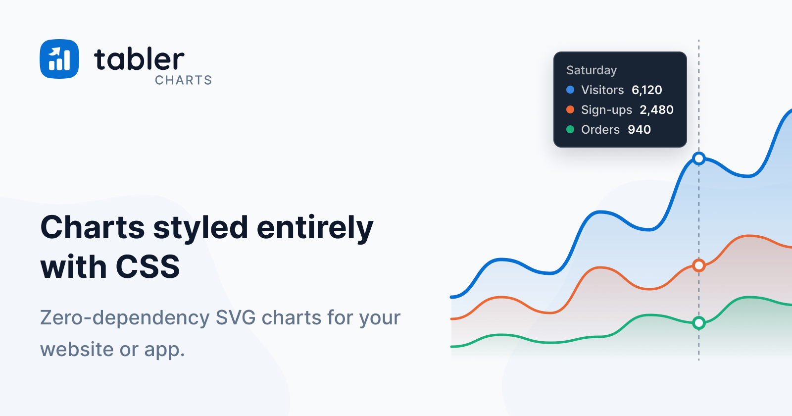

<p align="center">
  <picture>
    <source media="(prefers-color-scheme: dark)" srcset="https://raw.githubusercontent.com/tabler/tabler-charts/main/docs/images/logo-white.svg">
    
  </picture>
</p>

# @tabler/charts-bootstrap

[`@tabler/charts`](../core) for Bootstrap 5.3 and Tabler: a theme mapping (CSS and SCSS) and a data API, so charts can be declared in HTML.

<p align="center">
  <picture>
    <source media="(prefers-color-scheme: dark)" srcset="https://raw.githubusercontent.com/tabler/tabler-charts/main/docs/images/og-image-dark.png">
    
  </picture>
</p>

> 🚧 **Pre-release.** Not on npm yet; the API may still change.

```bash
npm install @tabler/charts @tabler/charts-bootstrap
```

## Theme

Load the mapping after the chart stylesheet:

```js
import '@tabler/charts/style.css'
import '@tabler/charts-bootstrap/bootstrap.css' // or tabler.css
```

What the mapping gives you:
- **Theme values:** charts use your theme's body font and colors, border colors, radius and shadow.
- **First series:** it takes `primary`. Series 2–8 keep the chart palette, which is checked for colorblind separation next to a blue primary; Bootstrap's own orange, yellow and pink are not.
- **Dark mode:** `data-bs-theme="dark"` switches the charts along with the rest of the page, on `<html>` or on any element.

The chart stylesheet itself already reads Tabler's `--tblr-*` variables (primary, named colors, card surface, borders, radius, shadow, font) with its own colors as fallbacks, so on a Tabler page charts follow the theme without this package. The Tabler preset, `tabler.css`, adds the theme-option scopes: the mapping is declared again on every element with `data-bs-theme-primary`, `-base`, `-font` or `-radius`, so a subtree with its own primary color or radius gets it. It leaves series 2–8 to the chart stylesheet (Tabler's named colors).

### SCSS

```scss
@use "@tabler/charts-bootstrap/scss/charts" with (
  $tc-series-1: var(--bs-success)
);
// Tabler:
@use "@tabler/charts-bootstrap/scss/tabler";
```

| Variable | Default | |
| --- | --- | --- |
| `$tc-prefix` | `"bs-"` | Bootstrap's CSS variable prefix (`$prefix`) |
| `$tc-theme-attribute` | `"data-bs-theme"` | The color mode attribute |
| `$tc-theme-scopes` | `:root, [data-bs-theme]` | Where the mapping is repeated |
| `$tc-series-1` | `var(--bs-primary)` | The first series' color |
| `$tc-palette-light`, `$tc-palette-dark` | the chart palette | Series 2–8, per mode |

The mapped variables are `$tc-surface`, `$tc-text-color`, `$tc-text-muted`, `$tc-grid-color`, `$tc-baseline-color`, `$tc-hover-color`, `$tc-font-family` and `$tc-tooltip-bg`, `-color`, `-muted`, `-border`, `-shadow` and `-radius`. The tooltip takes the theme's own tooltip colors (Bootstrap's emphasis color on the body background, Tabler's `--tblr-tooltip-bg`), so it inverts with the color mode like the page's tooltips; `tooltip: { theme: 'light' }` (or `data-tc-tooltip="light"`) keeps the white one.

## Data API

```html
<div data-tc-chart="line" data-tc-src="/api/sales.json" data-tc-aspect-ratio="3" data-tc-title="Sales"></div>

<div data-tc-chart="bar" data-tc-stacked="true" data-tc-legend="bottom">
  <script type="application/json">
    { "labels": ["Q1", "Q2"], "series": [{ "name": "North", "values": [3, 5] }] }
  </script>
</div>
```

```js
import { init } from '@tabler/charts-bootstrap'

await init() // every [data-tc-chart] on the page
```

- **Type:** `data-tc-chart` names the chart type.
- **Data:** it comes from `data-tc-src` (a JSON URL), an inline `<script type="application/json">`, or `data-tc-data`.
- **Options:** every other `data-tc-*` attribute is an option in camelCase (`data-tc-aspect-ratio="3"` becomes `aspectRatio: 3`).
  - Values are parsed: `true` and `false`, numbers, and JSON objects or arrays.
  - `data-tc-legend="bottom"` moves the legend.
  - `data-tc-download="true"` adds a download menu (PNG and SVG); `data-tc-download="svg png"` picks the formats.
  - `data-tc-options` takes a JSON object for the rest.
- **Loading:** while `data-tc-src` loads, the element has `aria-busy="true"`. A failed load or broken markup is reported without stopping the other charts.

| Function | |
| --- | --- |
| `init(root?, { types? })` | Create charts in `root` (default `document`) that do not have one yet. Resolves once the `data-tc-src` charts have loaded |
| `observe(root?, { types? })` | Also initialize charts added later and destroy removed ones; returns a function that stops |
| `getChart(element)` | The [`Chart`](../core#the-chart-instance) of an element |
| `dispose(element)` | Destroy an element's chart |

Chart events bubble out of the element as DOM events (`tc-hover`, `tc-click`, `tc-legend-toggle`, `tc-render`), with the payload in `detail`.

## CDN

One classic script with the library, the chart stylesheet with the Bootstrap mapping, and the data API:

```html
<script src="https://cdn.jsdelivr.net/npm/@tabler/charts-bootstrap/dist/tabler-charts-bootstrap.min.js"></script>
```

It injects the styles and initializes every `[data-tc-chart]` on load; everything is also on the `TablerCharts` global. On the script tag:
- `data-observe` also handles charts added later;
- `data-no-styles` skips the styles, so you can load them yourself;
- `nonce` (under a strict CSP) is passed on to the injected styles.

## License

MIT
