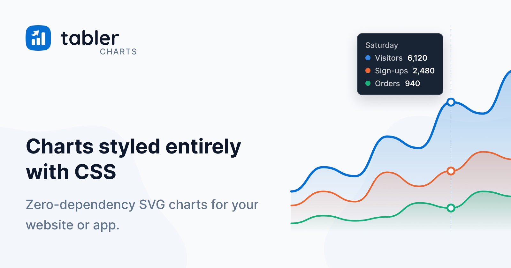

<p align="center">
  <picture>
    <source media="(prefers-color-scheme: dark)" srcset="https://raw.githubusercontent.com/tabler/tabler-charts/main/docs/images/logo-white.svg">
    
  </picture>
</p>

# @tabler/charts

Zero-dependency SVG charts styled with CSS: the engine, every chart type, the plugins and the stylesheet.

<p align="center">
  <picture>
    <source media="(prefers-color-scheme: dark)" srcset="https://raw.githubusercontent.com/tabler/tabler-charts/main/docs/images/og-image-dark.png">
    
  </picture>
</p>

> 🚧 **Pre-release.** Not on npm yet; the API may still change.

```bash
npm install @tabler/charts
```

## Quick start

```js
import { Chart, line } from '@tabler/charts'
import '@tabler/charts/style.css'

const chart = new Chart('#sales', {
  type: line,
  data: {
    labels: ['Jan', 'Feb', 'Mar', 'Apr'],
    series: [
      { name: 'Revenue', values: [42, 51, 47, 63] },
      { name: 'Costs', values: [31, 35, null, 40] }, // null leaves a gap
    ],
  },
  y: { format: { style: 'currency', currency: 'USD' } },
  locale: 'en-US',
})

chart.setData({ labels, series }) // new data animates from the old
```

The chart fills its container's width (height = width / `aspectRatio`, 2 by default) and follows it when it resizes.

## Two entries: everything, or only what you use

| Import | You get |
| --- | --- |
| `@tabler/charts` | `Chart` with every built-in plugin (highlight, tooltip, legend, data table, keyboard) and every optional feature registered |
| `@tabler/charts/core` | A bare `Chart` with no plugins and no features: add what you need |

```js
import { Chart, highlight, tooltip } from '@tabler/charts/core'
import { line } from '@tabler/charts/line'
import '@tabler/charts/time' // only if you use x: { type: 'time' }

new Chart('#el', { type: line, data, plugins: [highlight(), tooltip()] })
```

Chart types have their own entries (`@tabler/charts/line`, `/bar`, `/pie` …). Optional features register themselves when imported:

| Entry | Enables |
| --- | --- |
| `@tabler/charts/time` | `x: { type: 'time' }`: points at their real distance in time, calendar ticks, date labels |
| `@tabler/charts/log` | `y: { scale: 'log' }` |
| `@tabler/charts/decimate` | `decimate: 500` on line and area charts (LTTB downsampling) |
| `@tabler/charts/annotations` | `annotations` on line, area, bar and candlestick charts |
| `@tabler/charts/hydrate` | Taking over server-rendered markup node by node (otherwise it is replaced) |
| `@tabler/charts/export` | `exportSVG()`, `exportImage()`, `downloadChart()`, and the `download` menu option (also with the default `Chart`) |

A feature you use but did not import throws an error that names the import.

## Chart types

| Type | Data | Notable options |
| --- | --- | --- |
| `line` | `{ labels, series }` | `curve` (`'monotone'`, `'linear'`, `'step'` …), `points` (`'none'`, `'last'`, `'all'`), `area`, `stacked`, `connectNulls`, `decimate` |
| `area` | `{ labels, series }` | as `line`, filled; `fill: 'gradient' \| 'solid'` |
| `bar` | `{ labels, series }` | `stacked` (`true` or `'percent'`), `orientation: 'horizontal'`, `radius`, `gap`, `maxBarWidth`; `series[].type: 'line' \| 'area'` mixes in lines |
| `pie`, `donut` | `[{ name, value }]` | `innerRadius`, `gap`, `cornerRadius`, `center` (text in the middle) |
| `gauge` | a number, a ring or rings | `max`, `startAngle`, `angle` (`270` for a dial), `thickness`, `center` |
| `radar` | `{ labels, series }` | `grid: 'polygon' \| 'circle'`, `fill`, `points`, `r` (radial axis), `labelWidth` (long spoke labels wrap at their spaces, by default past a quarter of the width) |
| `sankey` | `{ nodes?, links: [{ from, to, value }] }` | `nodeWidth`, `nodePadding`, `align: 'justify' \| 'left'`, `format`; nodes with a `color` make the legend |
| `parliament` | `[{ name, seats }]` | `total` (vacant seats), `rows`, `angle` (`180` for a hemicycle), `innerRadius`, `gap`, `center` |
| `treemap` | `[{ name, value }]`, or groups `[{ name, children }]` | `gap`, `radius`, `labels` (names and values in the tiles), `format`; `--tc-treemap-opacity` fades the tiles |
| `scatter` | `{ series: [{ name, points: [{ x, y, size? }] }] }` | `radius`, `size` (bubble radii); points with `size` are bubbles |
| `heatmap` | `{ labels, series }` (rows) | `min`, `max`, `ranges`, `colors` + `mid` (scales), `colorBy: 'series'` |
| `candlestick` | `[{ x, open, high, low, close }]` | time axes, `maxCandleWidth` |
| `sparkline` | `number[]` | `variant` (`'line'`, `'area'`, `'bar'`, `'tristate'`), `point`, `markers: 'minmax'` |

`types` (from `@tabler/charts`) has every type by its name, for charts declared in markup (`types[name]`); it brings all of them into the bundle.

Series take `name`, `values`, and optionally `id` (stable identity), `color`, `dash`, `width`, `class` and `hidden`.

Cartesian charts share two axes:
- `x`: `format`, `type: 'time'`, `utc`, `grid`, `line`, `show`.
- `y`: `min`, `max`, `zero`, `nice`, `ticks`, `format`, `scale: 'log'`, `grid`, `show`.

A number `format` is `Intl.NumberFormat` options or a function. `notation: 'compact'` shortens long numbers in the locale's words ("1.1M", "1,1 mln" in Polish); `compactSymbols` writes suffixes of your own in the locale's separators instead:

```js
y: { format: { notation: 'compact', compactSymbols: true } }            // 1K, 1,1M, 2,5B in pl-PL
y: { format: { notation: 'compact', compactSymbols: ['k', 'M', 'G'] } } // 1k, 1.1M, 2.5G
```

They also share `annotations`:

```js
annotations: [
  { y: 99.9, label: 'SLA' },             // a line at a value
  { y: [40, 60], label: 'Normal' },      // a band between values
  { x: 'Jun', label: 'Launch' },         // a line at a category (or a date)
]
```

### Value labels

`valueLabels: true` writes the values on the marks: bars at their end (inside when there is no room outside), stacked segments and heatmap cells inside, slices their share, lines and scatters above their last point (`valueLabels: { points: 'all' }` for every point). Values take the axis format (`valueLabels: { format }` overrides it). A label that does not fit its mark or the chart, or would cover another label or mark, is left out: labels never overlap. On the core, `import '@tabler/charts/value-labels'` enables them.

```js
new Chart('#el', { type: bar, data, valueLabels: true })
```

A chart type of your own gets labels from its hits like the built-in ones. Its `valueLabels` says what its marks are, when not bars or points (`{ marks: 'slice' }` for shares inside slices, `{ marks: 'cell' }` for values in the middle of cells), and where its number format is (`{ format: (options) => options.format }`).

### Synced hover

Charts with the same `sync` group share the hover: the category under the pointer is highlighted in every chart of the group, with its crosshair and tooltip, and they clear together. Categories are matched by label, so the charts need not have the same data; a chart without that label clears. Keyboard highlights stay in their own chart. On the core, add the `sync()` plugin.

```js
new Chart('#visitors', { type: line, data: visitors, sync: 'week' })
new Chart('#signups', { type: bar, data: signups, sync: 'week' })
```

### Data from outside

Data, annotations and axis bounds often come from users, APIs or JSON and are not always what the types say. Charts take them as they are and never throw or draw `NaN` over them: a value that is not a finite number (`null`, `'42'`, `NaN`, `Infinity`, an object) is a gap, as are numbers too large to plot (beyond ±1e300); names become text; a color that is not a string falls back to the palette; series, slices, points or annotations that are not objects are left out. Numbers in strings are not parsed: convert them first if your API sends them.

An option that is `NaN` or infinite (a `radius`, a `startAngle`, a `width`, a side of `padding`…) counts as left out: its default applies.

## Options every chart takes

| Option | Default | |
| --- | --- | --- |
| `width`, `height` | container width, width / `aspectRatio` | `height: 'container'` follows the container's height |
| `aspectRatio` | `2` | |
| `title`, `description` | | Accessible name and description; without a title the name lists the series ("line chart: Revenue, Costs") |
| `locale` | runtime default | For `Intl` number and date formatting; set it for SSR |
| `rtl` | `false` | Mirror line, area, bar and candlestick charts for right-to-left pages: value axis on the right, categories from the right (`x: { reverse: false }` keeps those). Horizontal bars grow to the left. `'auto'` follows the container's `direction` |
| `fontSize` | `--tc-font-size` | Used to lay out labels; set it for SSR |
| `id` | generated | Prefix of ids inside the SVG; set it for SSR |
| `legend` | for 2+ entries | `false`, `true` or `{ position: 'bottom' }` |
| `tooltip` | `true` | `false`, or `{ theme, format, footer }`: `theme: 'light'` for a white tooltip instead of the dark one, `format` and `footer` for custom content |
| `crosshair` | `true` | |
| `table` | `true` | Hidden data table for screen readers; `'visible'` shows it |
| `keyboard` | `true` | Arrow keys walk the data; sparklines opt out |
| `animate` | `true` | Charts with more than 1000 elements skip transitions unless `true` |
| `patterns` | `'auto'` | Pattern fills: `true` always, `'auto'` in forced colors only, `false` never |
| `valueLabels` | `false` | Values on the marks: `true`, or `{ points: 'all', format }` (see below) |
| `sync` | | A group name: charts of the same group share the hover (see below) |
| `shapes` | with `patterns: true` | A point shape per series in line, radar and scatter charts |
| `class` | | Extra classes on the `<svg>` |
| `plugins` | | Extra plugins |

## The `Chart` instance

```js
chart.update({ stacked: true })       // merge options, re-render in the next frame
chart.setConfig({ type: bar, data })  // replace every option: the ones left out go back to defaults
chart.setData(data)
chart.toggleSeries('Costs')           // by key, name or index
chart.highlightIndex(2)               // as keyboard navigation does
chart.clearHighlight()
chart.resize()
chart.destroy()

const off = chart.on('hover', ({ hit }) => {}) // also: click, legend-toggle, render
```

`chartEvents` lists the event names, for code that passes all of them on (as the adapters do).

Updates are batched into one animation frame for every chart on the page. `flush()` runs them right away (useful in tests).

An element holds one chart: a new `Chart` on it replaces the one already there. Call `destroy()` when the chart goes away (the React, Vue, element and data API wrappers do it for you). A container taken out of the page without it is still let go, and if you put the same container back, call `chart.resize()` so it follows its size again.

## Theming

Everything visual is CSS. The stylesheet defines tokens on `:root` (light and dark), and every element has semantic classes:

```css
.revenue-chart {
  --tc-color-1: oklch(60% 0.2 250);  /* palette slots --tc-color-1 … 8 */
  --tc-stroke-width: 3px;
  --tc-font-size: 13px;
}
.revenue-chart .tc-series-2 .tc-line { stroke-dasharray: 4 4; }
```

Tokens include `--tc-color-1` … `--tc-color-8`, `--tc-surface`, `--tc-text-color`, `--tc-text-muted`, `--tc-grid-color`, `--tc-baseline-color`, `--tc-font-family`, `--tc-font-size`, `--tc-stroke-width`, `--tc-area-opacity`, `--tc-duration`, `--tc-easing` and the `--tc-tooltip-*` set (`-bg`, `-color`, `-muted`, `-border`, `-shadow`, `-radius`, and `--tc-tooltip-light-*` for the white variant).

On a [Tabler](https://tabler.io) page the colors come from the theme: each color token reads the matching `--tblr-*` variable first (`--tc-color-1` is `--tblr-primary`, series 2–8 are Tabler's orange, teal, yellow, pink, green, indigo and red, the surface is `--tblr-bg-surface`, text and borders, radius, shadow and font follow too) and falls back to the chart's own palette when the variable is not defined. Tabler switches its variables for dark mode itself; without Tabler the fallbacks have their own dark values.

Colors given in data (`series.color`, slice, ring, heatmap and annotation colors, `series.dash`) may come from users: any CSS color works, `var(--…)` and `color-mix()` included, but a value that could inject CSS (a `;`, quotes, `url()` and the like) is ignored and the palette color stays.

Dark mode follows `prefers-color-scheme`, and `data-theme="dark"` / `"light"` on any ancestor overrides it. `prefers-reduced-motion` turns animations off, and forced colors (Windows High Contrast) are supported.

## Server-side rendering

```js
import { chartToString, line } from '@tabler/charts'

const svg = chartToString(
  { type: line, data, id: 'sales', locale: 'en-US', fontSize: 12 },
  { width: 600, height: 300 },
)
```

Put the SVG in the chart's container. A `Chart` created on the same element later takes the markup over node by node (with `@tabler/charts`, or `@tabler/charts/hydrate` on the core). Set `id`, `locale` and `fontSize` explicitly so the server and browser layouts match. The React and Vue adapters do all of this for you.

## Content Security Policy

Charts work under a strict CSP (`style-src 'self'`, no `'unsafe-inline'`): the browser renderer sets styles through the CSSOM, which such a policy allows, and injects no `<style>` elements. Server-rendered markup is the exception: the browser blocks (and reports) its style attributes as it parses the page, and hydration then sets them again, so the chart still ends up right. The React and Vue components always start from that markup. To keep the reports out, allow style attributes only: `style-src 'self'; style-src-attr 'unsafe-inline'`.

## Export

```js
import { downloadChart, exportImage, exportSVG } from '@tabler/charts'

const svg = exportSVG(chart)                          // standalone SVG string
const png = await exportImage(chart, { scale: 3 })    // Blob; also image/jpeg, image/webp
await downloadChart(chart, { format: 'svg' })         // saves "<title>.svg"
```

The export copies the computed styles into the SVG, so CSS theming comes along. It also draws the legend in, leaves hover marks out and paints the surface color behind the chart (`background: false` for none).

Or let the chart offer it: `download: true` puts a small menu button in the chart's corner (`.tc-download`) with PNG and SVG. A list picks the formats, an object also sets the file name and the export options:

```js
new Chart('#sales', { type: line, data, download: true })
new Chart('#sales', { type: line, data, download: ['png', 'svg', 'jpeg', 'webp'] })
new Chart('#sales', { type: line, data, download: { formats: ['svg'], filename: 'sales', background: false, scale: 3 } })
```

The menu is a `download()` plugin (in the default `Chart`; install it yourself on the core). The saving comes from `import '@tabler/charts/export'`, so charts without a download menu never carry the export code; the chart tells you when the import is missing.

## Accessibility

- **Name and description:** every chart is a `role="img"` with an accessible name and, with `description`, a description.
- **Data table:** a data table is there for screen readers; it is visually hidden unless `table: 'visible'`.
- **Keyboard:** Left and Right walk the categories, Up and Down the series, Home and End jump to the ends, and Escape clears the highlight. The tooltip follows.
- **Palette:** the default palette is checked for colorblind separation, and the legend gives every series a name, never color alone.
- **Point shapes:** with `shapes: true` (and with `patterns: true`), the points of line, radar and scatter charts and the active points of the hover take a shape per series (circle, square, triangle, diamond, triangle down, plus, cross, star), and so do the legend and tooltip swatches. On the core, `import '@tabler/charts/point-shapes'` enables them.
- **Patterns:** with `patterns: true`, bars, areas, slices, rings and bubbles wear a pattern of their color slot (diagonal lines, dots, hatching, grid…) and lines a dash, so series do not depend on color at all (color vision deficiency, grayscale print). The legend and tooltip swatches match, and exports keep them. By default (`'auto'`) they appear only in forced colors (Windows High Contrast), where the colors are gone. `--tc-pattern-color` sets the color of the lines and dots (the surface by default). On the core, `import '@tabler/charts/patterns'` enables them.

## License

MIT
