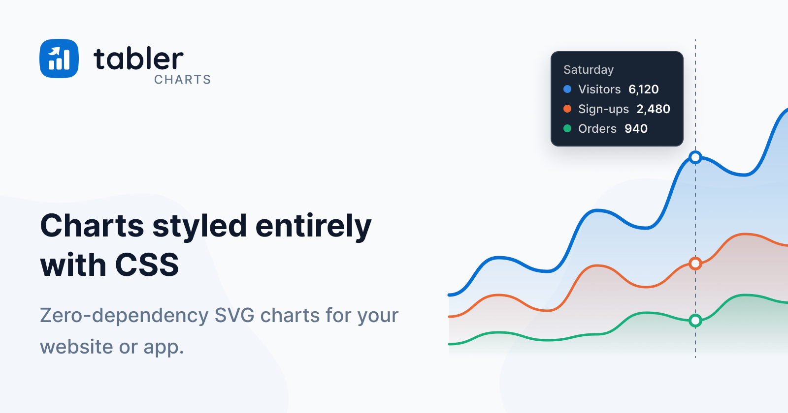

<p align="center">
  <picture>
    <source media="(prefers-color-scheme: dark)" srcset="https://raw.githubusercontent.com/tabler/tabler-charts/main/docs/images/logo-white.svg">
    
  </picture>
</p>

# @tabler/charts-elements

The `<tabler-chart>` Web Component for [`@tabler/charts`](../core). Use it in plain HTML or with any framework (Svelte, Angular, Astro …), in light DOM by default or in a shadow root.

<p align="center">
  <picture>
    <source media="(prefers-color-scheme: dark)" srcset="https://raw.githubusercontent.com/tabler/tabler-charts/main/docs/images/og-image-dark.png">
    
  </picture>
</p>

> 🚧 **Pre-release.** Not on npm yet; the API may still change.

```bash
npm install @tabler/charts @tabler/charts-elements
```

## Usage

```js
import { defineChartElement } from '@tabler/charts-elements'
import '@tabler/charts/style.css'

defineChartElement() // registers <tabler-chart> with every chart type
```

```html
<tabler-chart type="line" label="Visitors" aspect-ratio="3">
  <script type="application/json">
    { "labels": ["Mon", "Tue", "Wed"], "series": [{ "name": "Visitors", "values": [3, 5, 4] }] }
  </script>
</tabler-chart>
```

The element renders into itself (light DOM), so the page CSS and the `--tc-*` tokens style it as usual.

## Attributes and properties

| Attribute | Option |
| --- | --- |
| `type` | The chart type: `line`, `area`, `bar`, `pie`, `donut`, `gauge`, `radar`, `sankey`, `parliament`, `percentage-bar`, `treemap`, `scatter`, `heatmap`, `candlestick`, `sparkline` |
| `label` | `title` (the accessible name) |
| `description` | `description` |
| `width`, `height`, `aspect-ratio` | Size; `height="container"` follows the element's height |
| `locale` | `locale` |
| `rtl` | `rtl` (`rtl="auto"` follows the page) |
| `legend`, `tooltip`, `animate`, `keyboard`, `table` | `"false"` turns them off; `legend="bottom"` moves the legend, `tooltip="light"` picks the white tooltip, `table="visible"` shows the data table |
| `patterns` | pattern fills: present (or `"true"`) always, `"auto"` in forced colors only (the default), `"false"` never |
| `value-labels` | values on the marks: present (or `"true"`), or `"all"` for every point of a line |
| `sync` | a group name: elements of the same group share the hover |
| `shapes` | a point shape per series (present, or `"true"`) |
| `download` | a download menu in the corner: present (or `"true"`) for PNG and SVG, or the formats, `download="svg png"` |
| `options` | JSON with any other option, e.g. `options='{"stacked": true}'` |

Data comes from the inline `<script type="application/json">`, or from the `data` property, which wins:

```js
const el = document.querySelector('tabler-chart')
el.data = { labels, series }       // re-renders
el.options = { stacked: true }     // merged under the attributes
el.chart                            // the Chart instance, while connected
```

Changing an attribute, the property or the script's text updates the chart; changing `type` rebuilds it.

## Events

Chart events bubble out of the element as DOM events, with the payload in `detail`. They are `tc-hover`, `tc-click`, `tc-legend-toggle` and `tc-render`.

```js
el.addEventListener('tc-click', (event) => console.log(event.detail.hit))
```

## Shadow DOM

```js
import { defineChartElement } from '@tabler/charts-elements'
import { shadow } from '@tabler/charts-elements/shadow'

defineChartElement({ shadow })
```

- **Styles:** the element renders into a shadow root and adopts the chart stylesheet itself, so you do not import `style.css`.
- **Styling the pieces:** page CSS does not reach inside. Use `tabler-chart::part(root | chart | legend | tooltip | table | download)` instead.
- **Theming:** set tokens on the element itself (`tabler-chart { --tc-color-1: … }`), and `data-theme="dark"` on it or on an ancestor.

## Fewer types, smaller bundle

`@tabler/charts-elements/core` registers only the types and plugins you pass:

```js
import { defineChartElement } from '@tabler/charts-elements/core'
import { highlight, tooltip } from '@tabler/charts/core'
import { line } from '@tabler/charts/line'

defineChartElement({ types: { line }, plugins: () => [highlight(), tooltip()] })
```

Both entries take `tag` to register under another name.

## CDN

One classic script with the library, the stylesheet and the element, which registers itself:

```html
<script src="https://cdn.jsdelivr.net/npm/@tabler/charts-elements/dist/tabler-charts.min.js"></script>
```

The library is also on the `TablerCharts` global. Add `data-no-styles` to the script tag to load the stylesheet yourself. Under a strict CSP, give the script a `nonce`: the injected styles take it over.

## License

MIT
