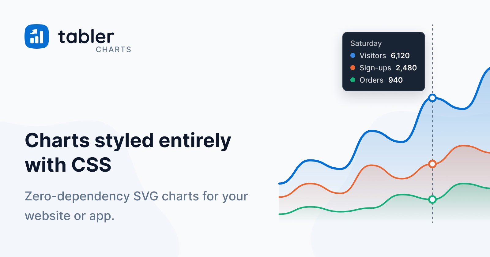

<p align="center">
  <picture>
    <source media="(prefers-color-scheme: dark)" srcset="https://raw.githubusercontent.com/tabler/tabler-charts/main/docs/images/logo-white.svg">
    
  </picture>
</p>

# @tabler/charts-vue

Vue 3 components and a composable for [`@tabler/charts`](../core). Charts render to SVG on the server (Nuxt included), and the browser takes the markup over without re-creating it.

<p align="center">
  <picture>
    <source media="(prefers-color-scheme: dark)" srcset="https://raw.githubusercontent.com/tabler/tabler-charts/main/docs/images/og-image-dark.png">
    
  </picture>
</p>

> 🚧 **Pre-release.** Not on npm yet; the API may still change.

```bash
npm install @tabler/charts @tabler/charts-vue
```

Requires Vue 3.5 or newer.

## Usage

```vue
<script setup>
import { LineChart } from '@tabler/charts-vue'
import '@tabler/charts/style.css'

const data = { labels: ['Mon', 'Tue', 'Wed'], series: [{ name: 'Visitors', values: [3, 5, 4] }] }
</script>

<template>
  <LineChart :data="data" :aspect-ratio="3" locale="en-US" title="Visitors" />
</template>
```

There is one component per chart type: `LineChart`, `AreaChart`, `BarChart`, `PieChart`, `DonutChart`, `GaugeChart`, `RadarChart`, `SankeyChart`, `ParliamentChart`, `PercentageBarChart`, `TreemapChart`, `FunnelChart`, `ScatterChart`, `HeatmapChart`, `CalendarChart`, `CandlestickChart` and `Sparkline`. `TablerChart` takes the type as a prop:

```vue
<TablerChart :type="bar" :data="data" stacked />
```

## Props

Every chart option is an attribute, in kebab-case or camelCase: `:data`, `title`, `locale`, `:aspect-ratio`, `:legend`, and the type's own options (`stacked`, `curve` …).

- `class` and `style` go to the container `<div>`, as usual in Vue.
- `data` is watched deeply, so changing it in place (`data.series[0].values.push(…)`) updates the chart, and new data animates from the old.
- For SSR, pass `locale` so the server and browser format numbers the same. Ids come from `useId()`, so hydration lines up.
- The chart starts from server-rendered markup, also in the browser. Under a strict CSP (`style-src` without `'unsafe-inline'`) its style attributes are reported, then set again on mount; allow `style-src-attr 'unsafe-inline'` to keep the reports out (see the core README).

## Events

```vue
<BarChart
  :data="data"
  @hover="({ hit }) => (active = hit?.label)"
  @click="({ hit }) => select(hit)"
  @legend-toggle="({ name, hidden }) => {}"
  @render="({ size }) => {}"
/>
```

## The `Chart` instance

A template ref exposes `chart`, the [`Chart`](../core#the-chart-instance):

```vue
<script setup>
import { ref } from 'vue'
const revenue = ref()
// revenue.value.chart.toggleSeries('Costs')
</script>

<template>
  <LineChart ref="revenue" :data="data" />
</template>
```

## `useChart()`

To render into an element of your own:

```js
import { ref } from 'vue'
import { line } from '@tabler/charts'
import { useChart } from '@tabler/charts-vue'

const el = ref(null)
const chart = useChart(el, () => ({ type: line, data: data.value }))
```

`useChart()` returns a shallow ref to the chart. It creates the chart once the element is there, follows the config deeply and destroys it with the component. It does not render on the server; use the components for SSR.

## License

MIT
